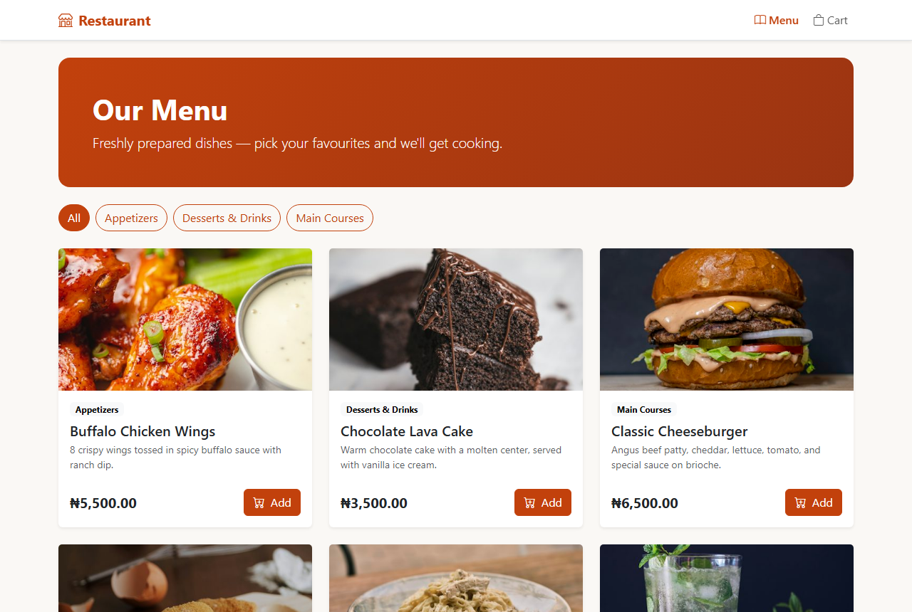
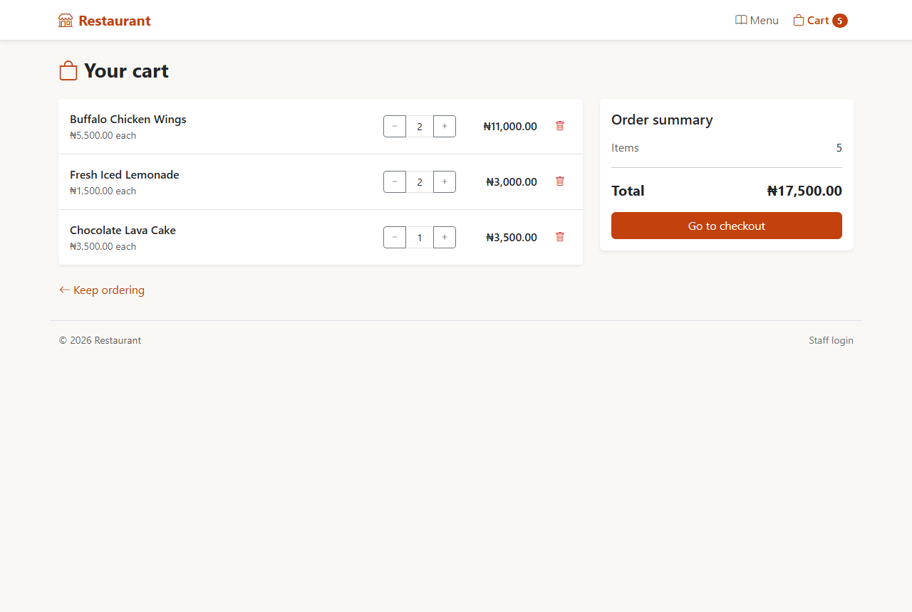
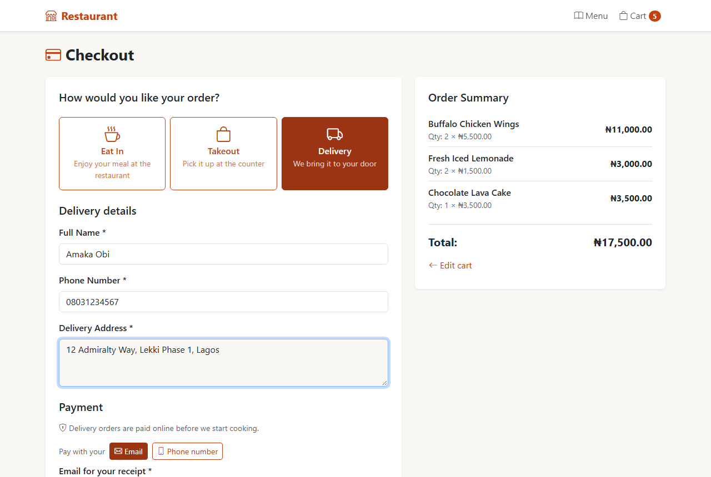
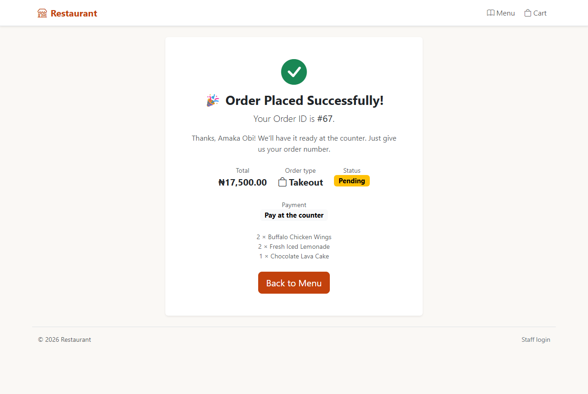
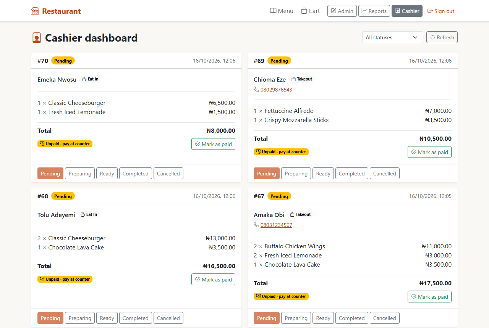
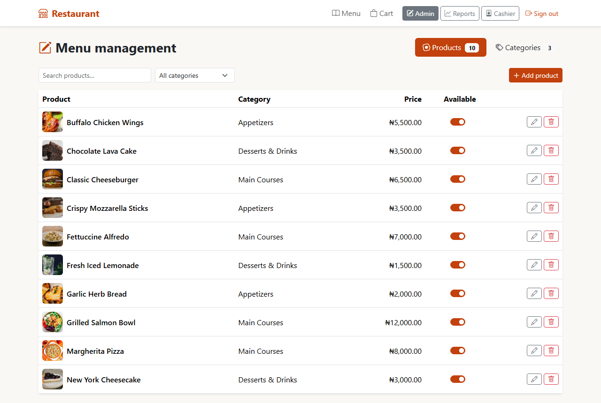
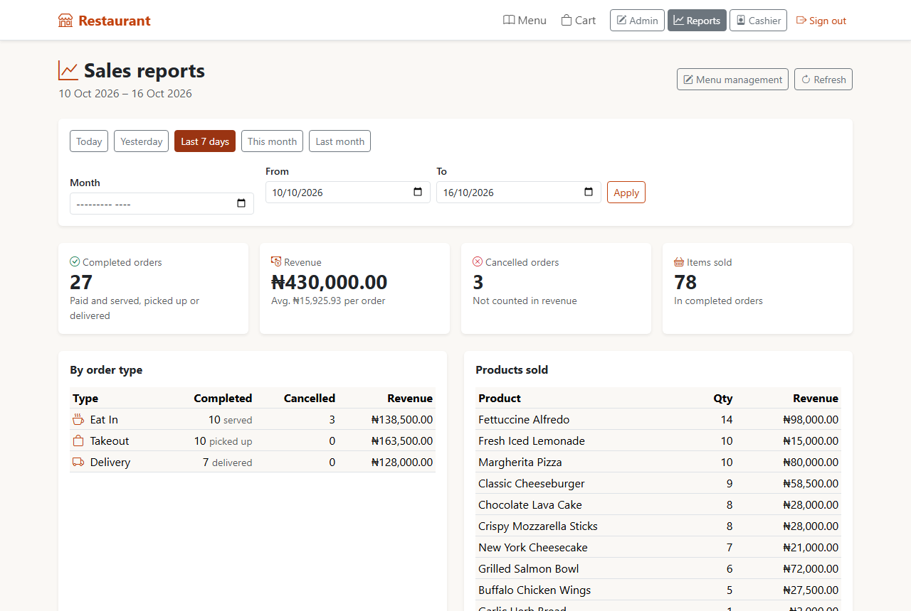
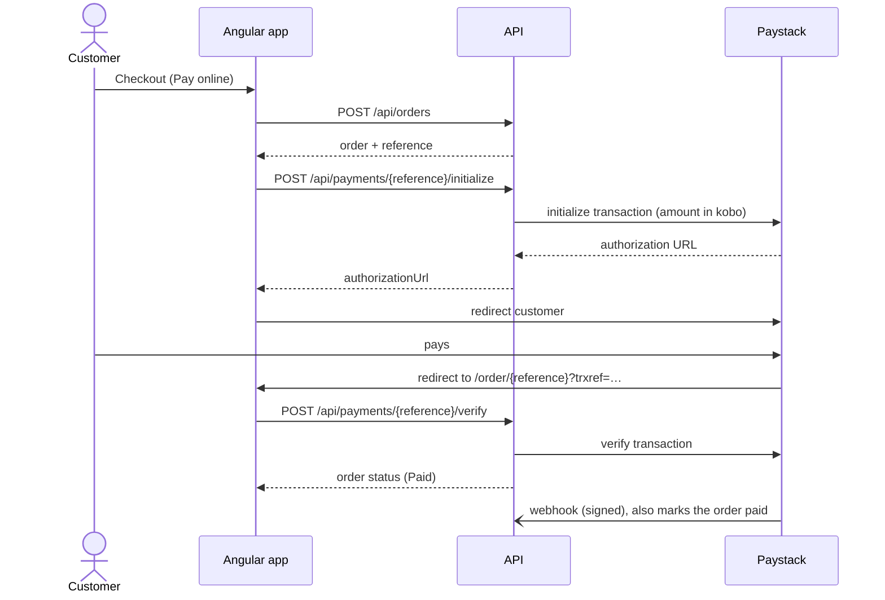

# RestaurantApp

A full-stack restaurant ordering system. Customers browse the menu, build a cart and check out for **dine-in, takeout or delivery**, paying online with **Paystack** or at the counter. Staff sign in to run the kitchen queue, manage the menu and see sales reports.

**[▶ Try the live demo](https://ola20sarumi.github.io/RestaurantApp/)**: runs entirely in your browser, nothing to install. **[📖 Browse the Storybook](https://main--6ae88aa2ee7b92144381fd43.chromatic.com)**: every UI component and page state, published from `main`.

[](https://github.com/ola20sarumi/RestaurantApp/actions/workflows/playwright.yml)
[](https://github.com/ola20sarumi/RestaurantApp/actions/workflows/chromatic.yml)
[](https://www.chromatic.com/library?appId=6ae88aa2ee7b92144381fd43)


---

## Contents

- [Screenshots](#screenshots)
- [Try the demo](#try-the-demo)
- [Features](#features)
- [Tech stack](#tech-stack)
- [Getting started](#getting-started)
- [Configuration](#configuration)
- [Payments with Paystack](#payments-with-paystack)
- [API reference](#api-reference)
- [Testing](#testing)
- [Project structure](#project-structure)
- [License](#license)

---

## Screenshots

| Menu | Cart |
|---|---|
|  |  |
| **Checkout** | **Order confirmation** |
|  |  |
| **Cashier dashboard** | **Menu management** |
|  |  |

<p align="center">
  <br>
  <b>Sales reports</b>
</p>

---

## Try the demo

**Live demo: https://ola20sarumi.github.io/RestaurantApp/**

It's published to GitHub Pages on every push to `main` that changes the frontend ([`.github/workflows/pages.yml`](.github/workflows/pages.yml)). The frontend can be built as a **single, self-contained HTML file** that runs the whole app in the browser, with no API, database or Paystack account needed. The API is replaced by an in-browser stand-in (`frontend/src/demo/`) with a sample menu and two weeks of order history, and everything is saved only in the visitor's browser.

```bash
cd frontend
npm install
npm run build:demo        # → dist/demo/restaurant-demo.html
```

Open `dist/demo/restaurant-demo.html` in any browser, or share the file. A banner at the top shows the staff logins for the demo and has a **Reset demo** button. Online payment goes to a stand-in payment page instead of Paystack.

---

## Features

### Customers (no account needed)
- **Menu** grouped by category, with prices in naira (₦).
- **Cart** that persists in the browser and survives page reloads.
- **Checkout** for **Dine-in**, **Takeout** or **Delivery**. The form only asks for what the chosen option needs (name, phone, delivery address).
- **Pay online** through Paystack (by email or phone number), or **pay at the counter** with cash or POS.
- **Order tracking page** at a private, unguessable link (`/order/<reference>`) showing payment and preparation status.

### Cashier
- Live order queue that moves orders through `Pending → Preparing → Ready → Completed` (or `Cancelled`).
- Mark counter orders as paid.
- Online orders appear only once Paystack has confirmed payment.

### Admin
- Everything a cashier can do.
- **Menu management**: add, edit and delete categories and products, or mark products unavailable.
- **Sales reports** for any date range up to a year: revenue, orders by type, a daily breakdown and best-selling products, all in the viewer's time zone.

### Under the hood
- **Server-side rendering** (Angular SSR) with hydration, so public pages load fast and are indexable.
- **JWT staff auth** with role-based access (`Admin`, `Cashier`).
- **Server-side pricing**: the client sends only product IDs and quantities, and the API works out the total.
- **Safe payment confirmation**: an order is marked paid only when Paystack confirms the exact amount and currency, through the redirect check or a signed webhook (HMAC-SHA512). Both paths are idempotent.
- **Consistent errors**: every error is returned as RFC 7807 problem details JSON.
- **End-to-end tests** in Playwright run on every push and pull request, against a real SQL Server and a fake Paystack.
- **Component tests**: Storybook stories with interaction tests for the UI components and pages, and visual regression tests in Chromatic.

---

## Tech stack

| Layer | Technology |
|---|---|
| Frontend | Angular 19 (standalone components, signals, `@if`/`@for`), Angular SSR, Bootstrap 5, Bootstrap Icons |
| Backend | ASP.NET Core Web API on .NET 10, controllers, built-in OpenAPI |
| Data | Entity Framework Core 10 with SQL Server |
| Auth | JWT bearer tokens (HS256), ASP.NET Core `PasswordHasher` |
| Payments | Paystack (initialize, verify, webhook) |
| Testing | Playwright (e2e), Storybook 10 interaction tests, Chromatic (visual regression), Karma + Jasmine (unit) |
| CI | GitHub Actions with a SQL Server 2022 service container |

---

## Getting started

### Prerequisites

- [.NET 10 SDK](https://dotnet.microsoft.com/download)
- [Node.js](https://nodejs.org/) 18.19+ or 20+ and npm
- SQL Server (LocalDB, Express, Developer or Docker)
- EF Core CLI: `dotnet tool install --global dotnet-ef`
- *(Optional)* a [Paystack](https://paystack.com) test account for online payments

### 1. Clone

```bash
git clone https://github.com/ola20sarumi/RestaurantApp.git
cd RestaurantApp
```

### 2. Set up the database and run the API

```bash
cd backend
dotnet ef database update   # creates RestaurantDb, seeds a sample menu and staff logins
dotnet run                  # http://localhost:5044
```

The default connection string uses Windows authentication against a local SQL Server instance:

```
Server=localhost;Database=RestaurantDb;Trusted_Connection=True
```

If yours is different (SQL auth, Docker, LocalDB), override it with an environment variable or user secrets:

```bash
dotnet user-secrets set "ConnectionStrings:DefaultConnection" "Server=localhost,1433;Database=RestaurantDb;User Id=sa;Password=<password>;TrustServerCertificate=True"
```

### 3. Run the frontend

```bash
cd frontend
npm install
npm start                   # http://localhost:4200
```

Open **http://localhost:4200** to see the menu.

### 4. Sign in as staff

The staff login link is in the page footer (`/login`). The development seed creates one **Admin** and one **Cashier** account from the `StaffAccounts` section of `backend/appsettings.Development.json`, where you'll find their usernames and passwords.

> Staff accounts are created only when the `Users` table is empty, so editing `StaffAccounts` later won't change existing logins. Use your own strong credentials in any shared or production environment.

---

## Configuration

Settings are read from `appsettings*.json`, [user secrets](https://learn.microsoft.com/aspnet/core/security/app-secrets) (development) or environment variables (`Section__Key`).

| Setting | Required | Description |
|---|---|---|
| `ConnectionStrings:DefaultConnection` | Yes | SQL Server connection string |
| `Cors:AllowedOrigins` | Yes | Frontend origins allowed to call the API. The API won't start without at least one. |
| `Jwt:Key` | Yes | JWT signing key, at least 32 bytes. Never commit a production key. |
| `StaffAccounts` | First run | Staff logins created when the database is seeded |
| `Paystack:SecretKey` | For online pay | Paystack secret key (`sk_test_…` / `sk_live_…`). Without it, online payment is switched off and "Pay now" returns 503. |
| `Paystack:CallbackUrl` | For online pay | Where Paystack sends customers back to; `{reference}` is replaced with the order reference, e.g. `https://<frontend>/order/{reference}` |
| `Paystack:PhoneOnlyEmailDomain` | No | Domain used to build an email for phone-only payers (default `example.com`) |

The frontend's API address lives in one place: `frontend/src/app/api.config.ts` (`API_BASE_URL`).

---

## Payments with Paystack



**Local setup**

```bash
cd backend
dotnet user-secrets set "Paystack:SecretKey" "sk_test_xxxxxxxxxxxxxxxx"
```

To receive webhooks locally, expose the API through a tunnel (for example ngrok or Cloudflare Tunnel) and set `https://<tunnel>/api/payments/webhook` as the webhook URL in your Paystack dashboard.

Paystack test cards are listed in the [Paystack docs](https://paystack.com/docs/payments/test-payments/).

---

## API reference

Base URL in development: `http://localhost:5044/api`. The OpenAPI document is at `/openapi/v1.json`, and `backend/backend.http` has ready-made sample requests.

| Method | Endpoint | Access | Description |
|---|---|---|---|
| `GET` | `/categories` | Public | List categories |
| `POST` / `PUT` / `DELETE` | `/categories[/{id}]` | Admin | Manage categories |
| `GET` | `/products` | Public | Available products (`?includeUnavailable=true` for admins) |
| `GET` | `/products/{id}` | Public | Product details |
| `POST` / `PUT` / `DELETE` | `/products[/{id}]` | Admin | Manage products |
| `POST` | `/orders` | Public | Place an order |
| `GET` | `/orders` | Staff | List orders |
| `GET` | `/orders/{id}` | Staff | Order details |
| `PUT` | `/orders/{id}/status` | Staff | Update order status |
| `POST` | `/orders/{id}/mark-paid` | Staff | Mark a counter order as paid |
| `GET` | `/orders/report?from=&to=&timeZone=` | Admin | Sales report |
| `POST` | `/payments/{reference}/initialize` | Public | Start a Paystack payment |
| `POST` | `/payments/{reference}/verify` | Public | Confirm a payment and get order tracking info |
| `POST` | `/payments/webhook` | Paystack | Signed payment webhook |
| `POST` | `/auth/login` | Public | Staff login, returns a JWT |

**Example: place an order**

```http
POST /api/orders
Content-Type: application/json

{
  "fulfillmentType": "Takeout",
  "paymentMethod": "Counter",
  "customerName": "Ada",
  "customerPhone": "08012345678",
  "items": [
    { "productId": 1, "quantity": 2 },
    { "productId": 4, "quantity": 1 }
  ]
}
```

Rules: `Takeout` and `Delivery` need a phone number, `Delivery` also needs an address and must be paid online, and `Online` payment needs an email or phone number. Deleting a category that still has products, or a product that appears in past orders, returns `409 Conflict`. Mark the product unavailable instead.

---

## Testing

### End-to-end (Playwright)

```bash
cd frontend
npx playwright install chromium   # first time only
npm run e2e                       # all tests
npm run e2e -- tests/checkout.spec.ts
npx playwright show-report
```

Playwright always starts its own API, and starts the Angular dev server and a **fake Paystack** (`tests/fake-paystack.mjs`) unless they're already running.

The tests never touch your development database. Playwright runs the API against a **separate test database**, `RestaurantDb_E2E` on your local SQL Server, which it creates, migrates and seeds before the run (CI does the same on a throwaway SQL Server container). To put it on another server, set `E2E_CONNECTION_STRING`:

```bash
E2E_CONNECTION_STRING="Server=localhost,1433;Database=RestaurantDb_E2E;User Id=sa;Password=<password>;TrustServerCertificate=True" npm run e2e
```

Stop your own API before running the tests. Playwright always starts its own API, so it never reuses one connected to the development database, and it stops with a "port already used" error if port 5044 is taken.

| Spec | Covers |
|---|---|
| `menu.spec.ts` | Browsing the menu |
| `cart.spec.ts` | Adding, updating and removing cart items |
| `checkout.spec.ts` | Fulfillment types and validation |
| `payments.spec.ts` | Paystack payment flow (fake Paystack) |
| `cashier.spec.ts` | Order queue and status changes |
| `auth.spec.ts` | Staff login and route guards |
| `reports.spec.ts` | Sales reports |

### Unit tests

```bash
cd frontend
npm test -- --watch=false --browsers=Chrome
```

This opens a visible Chrome window that runs the tests and then closes.

### Component tests and visual regression

The UI is split into page components, which load data and call the API, and presentational components (`ProductCard`, `CartLine`, `OrderSummary`, `CheckoutForm`, `OrderCard`, `StatusBadge`), which only take inputs and emit outputs. Each layer of tests checks something different:

| Layer | What it checks | Where |
|---|---|---|
| Unit tests (Karma + Jasmine) | Each presentational component's rendering and events, in isolation | `*.spec.ts` |
| Storybook stories | Every state that matters, rendered in a real browser: each order status and payment state, each checkout order type, validation errors, long names, the highest price | `*.stories.ts` |
| Interaction tests | Play functions click and type like a user and assert what happens: "Add" emits the product, status buttons emit the status, checkout shows the right fields per order type and blocks invalid orders, and the menu, cart and cashier pages work against the demo API | `play` in `*.stories.ts` |
| Visual regression (Chromatic) | Screenshots every story and compares it with the approved baseline, so an unintended change to layout, colour or spacing shows up for review on the pull request | [Chromatic](https://www.chromatic.com) |
| End-to-end (Playwright) | Whole user journeys through the real stack: SSR, the API, SQL Server and the fake Paystack | `tests/` |

Both kinds of browser test are needed. Playwright proves the journeys work end to end, but it's slow, needs the API and a database, and doesn't notice if a badge turns the wrong colour. Stories are fast and fully deterministic, reach states that are hard to set up end to end, and give Chromatic something stable to compare.

Stories never call the network for data. Page stories run the real pages against the demo build's in-browser API (`src/demo`), starting from the demo menu and an order history built for a fixed date (`src/stories/demo-fixtures.ts`). Menu photos are served from `src/demo/images`. The only outside request is the Google Fonts stylesheet, the same one the app uses.

The Storybook for `main` is published by Chromatic at **https://main--6ae88aa2ee7b92144381fd43.chromatic.com**, and updates whenever `main` changes.

```bash
cd frontend
npm run storybook          # http://localhost:6006
npm run build-storybook    # static build in storybook-static/
npm run test-storybook     # interaction tests, headless (run build-storybook first)
CHROMATIC_PROJECT_TOKEN=<token> npm run chromatic   # publish to Chromatic from your machine
```

`npm run test-storybook` serves `storybook-static/` locally and runs every play function in Chromium with `@storybook/test-runner`. It uses the same Playwright browser as the e2e tests (`npx playwright install chromium`).

### Continuous integration

[`.github/workflows/playwright.yml`](.github/workflows/playwright.yml) runs the full e2e suite on every push and pull request to `main`, against a throwaway SQL Server 2022 container. [`.github/workflows/chromatic.yml`](.github/workflows/chromatic.yml) runs on pushes and pull requests that change the frontend: one job runs the Storybook interaction tests, and another publishes Storybook to Chromatic. Chromatic uses TurboSnap, so only stories affected by a change are snapshotted. Visual changes wait for review in Chromatic instead of failing the job, and changes merged to `main` become the new baseline. Without the `CHROMATIC_PROJECT_TOKEN` secret (for example, on pull requests from forks), the Chromatic job is skipped. [`.github/workflows/docker.yml`](.github/workflows/docker.yml) builds and runs the Docker Compose stack, and [`.github/workflows/pages.yml`](.github/workflows/pages.yml) publishes the demo.

---

## Project structure

```
RestaurantApp/
├── backend/                     ASP.NET Core Web API
│   ├── Auth/                    JWT options
│   ├── Controllers/             Auth, Categories, Products, Orders, Payments
│   ├── Data/                    AppDbContext and seed data
│   ├── Dtos/                    Request and response models
│   ├── Migrations/              EF Core migrations
│   ├── Models/                  Category, Product, Order, OrderItem, User
│   ├── Payments/                Paystack client and options
│   ├── Program.cs               Startup: CORS, JWT, EF Core, OpenAPI
│   └── backend.http             Sample requests
├── frontend/                    Angular 19 app with SSR
│   ├── .storybook/              Storybook configuration
│   ├── src/app/
│   │   ├── components/
│   │   │   ├── customer/        menu, cart, checkout, order-status pages; product-card, cart-line,
│   │   │   │                    order-summary, checkout-form components
│   │   │   ├── cashier/         dashboard page; order-card, status-badge components
│   │   │   ├── admin/           menu-admin, reports
│   │   │   └── auth/            login
│   │   ├── services/            API, cart and auth services, interceptor, guard
│   │   ├── models/              TypeScript models that mirror the API
│   │   └── api.config.ts        API base URL
│   ├── src/demo/                In-browser stand-in for the API (demo build and page stories)
│   ├── src/stories/             Shared story data and demo-API setup
│   └── tests/                   Playwright e2e tests
└── .github/workflows/           CI
```

---

## License

Released under the [MIT License](LICENSE).

Built by [@ola20sarumi](https://github.com/ola20sarumi).
