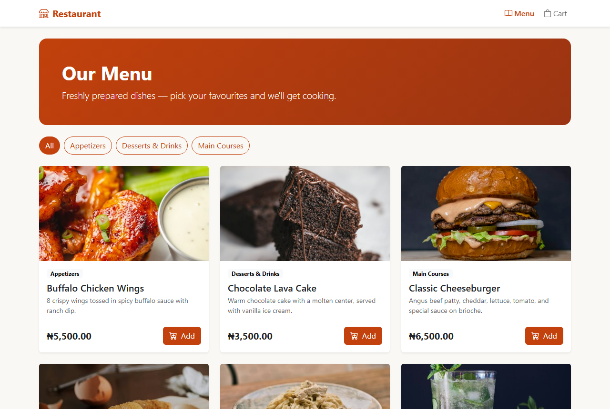
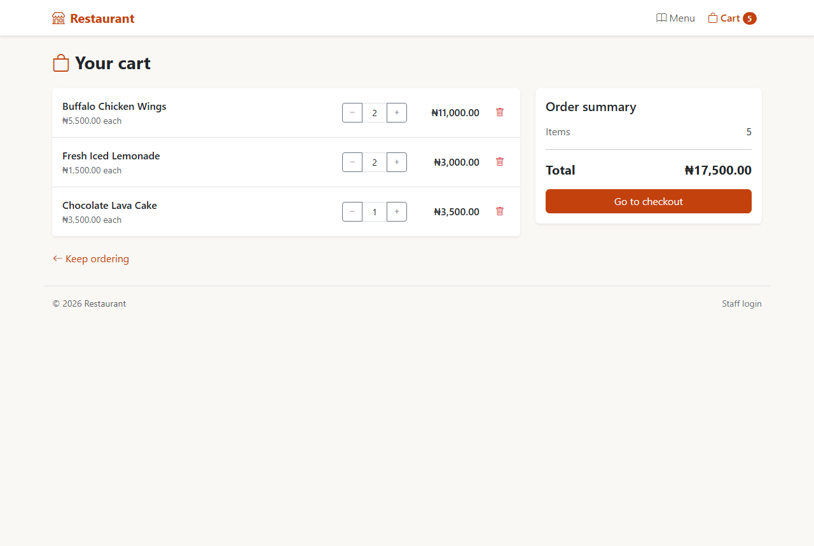
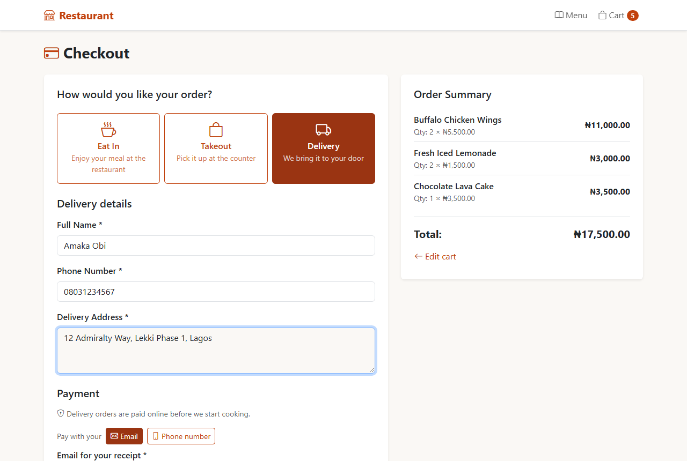
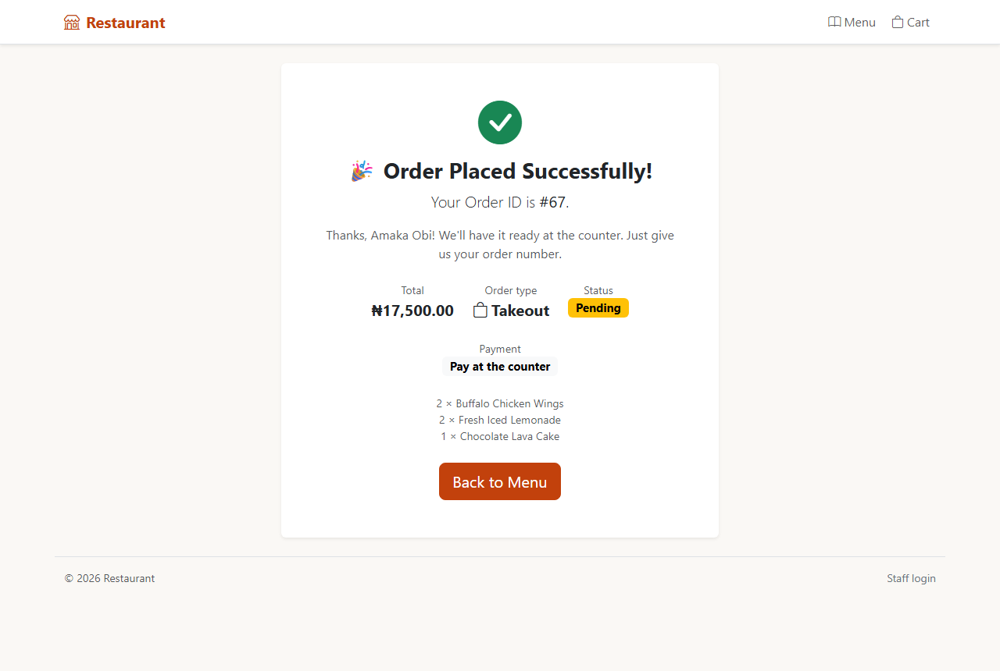
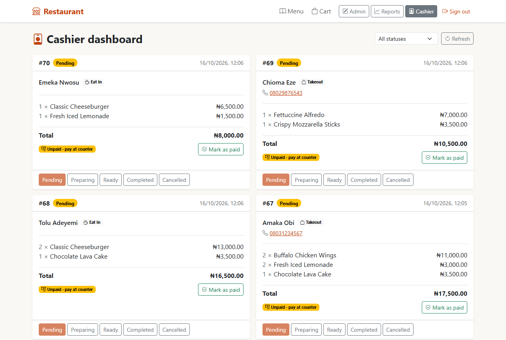
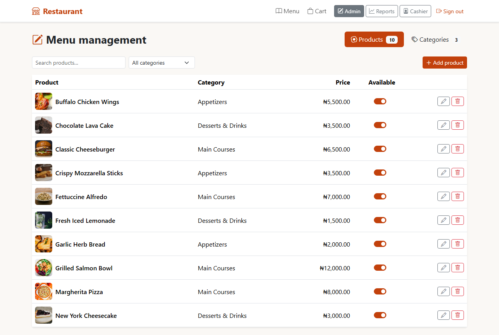
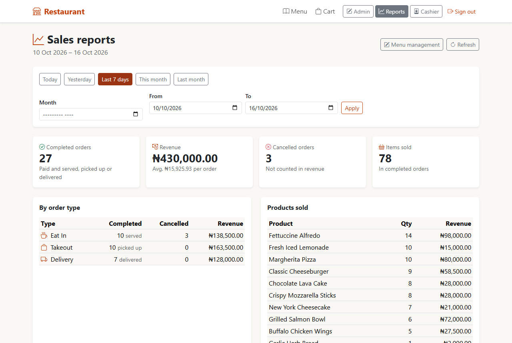
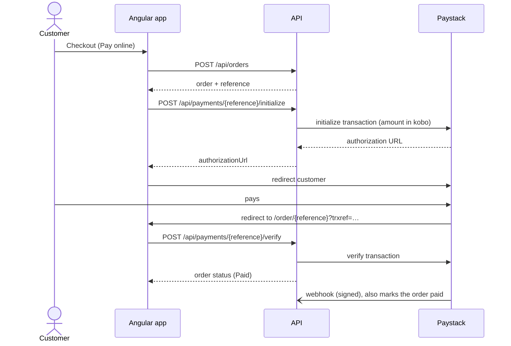

# RestaurantApp

A full-stack restaurant ordering system. Customers browse the menu, build a cart and check out for **dine-in, takeout or delivery**, paying online with **Paystack** or at the counter. Staff sign in to run the kitchen queue, manage the menu and see sales reports.

[](https://github.com/ola20sarumi/RestaurantApp/actions/workflows/playwright.yml)


---

## Contents

- [Screenshots](#screenshots)
- [Try the demo](#try-the-demo)
- [Features](#features)
- [Tech stack](#tech-stack)
- [Getting started](#getting-started)
- [Configuration](#configuration)
- [Payments with Paystack](#payments-with-paystack)
- [API reference](#api-reference)
- [Testing](#testing)
- [Project structure](#project-structure)
- [License](#license)

---

## Screenshots

| Menu | Cart |
|---|---|
|  |  |
| **Checkout** | **Order confirmation** |
|  |  |
| **Cashier dashboard** | **Menu management** |
|  |  |

<p align="center">
  <br>
  <b>Sales reports</b>
</p>

---

## Try the demo

The frontend can be built as a **single, self-contained HTML file** that runs the whole app in the browser, with no API, database or Paystack account needed. The API is replaced by an in-browser stand-in (`frontend/src/demo/`) with a sample menu and two weeks of order history, and everything is saved only in the visitor's browser.

```bash
cd frontend
npm install
npm run build:demo        # → dist/demo/restaurant-demo.html
```

Open `dist/demo/restaurant-demo.html` in any browser, or share the file. A banner at the top shows the staff logins for the demo and has a **Reset demo** button. Online payment goes to a stand-in payment page instead of Paystack.

---

## Features

### Customers (no account needed)
- **Menu** grouped by category, with prices in naira (₦).
- **Cart** that persists in the browser and survives page reloads.
- **Checkout** for **Dine-in**, **Takeout** or **Delivery**. The form only asks for what the chosen option needs (name, phone, delivery address).
- **Pay online** through Paystack (by email or phone number), or **pay at the counter** with cash or POS.
- **Order tracking page** at a private, unguessable link (`/order/<reference>`) showing payment and preparation status.

### Cashier
- Live order queue that moves orders through `Pending → Preparing → Ready → Completed` (or `Cancelled`).
- Mark counter orders as paid.
- Online orders appear only once Paystack has confirmed payment.

### Admin
- Everything a cashier can do.
- **Menu management**: add, edit and delete categories and products, or mark products unavailable.
- **Sales reports** for any date range up to a year: revenue, orders by type, a daily breakdown and best-selling products, all in the viewer's time zone.

### Under the hood
- **Server-side rendering** (Angular SSR) with hydration, so public pages load fast and are indexable.
- **JWT staff auth** with role-based access (`Admin`, `Cashier`).
- **Server-side pricing**: the client sends only product IDs and quantities, and the API works out the total.
- **Safe payment confirmation**: an order is marked paid only when Paystack confirms the exact amount and currency, through the redirect check or a signed webhook (HMAC-SHA512). Both paths are idempotent.
- **Consistent errors**: every error is returned as RFC 7807 problem details JSON.
- **End-to-end tests** in Playwright run on every push and pull request, against a real SQL Server and a fake Paystack.

---

## Tech stack

| Layer | Technology |
|---|---|
| Frontend | Angular 19 (standalone components, signals, `@if`/`@for`), Angular SSR, Bootstrap 5, Bootstrap Icons |
| Backend | ASP.NET Core Web API on .NET 10, controllers, built-in OpenAPI |
| Data | Entity Framework Core 10 with SQL Server |
| Auth | JWT bearer tokens (HS256), ASP.NET Core `PasswordHasher` |
| Payments | Paystack (initialize, verify, webhook) |
| Testing | Playwright (e2e), Karma + Jasmine (unit) |
| CI | GitHub Actions with a SQL Server 2022 service container |

---

## Getting started

### Prerequisites

- [.NET 10 SDK](https://dotnet.microsoft.com/download)
- [Node.js](https://nodejs.org/) 18.19+ or 20+ and npm
- SQL Server (LocalDB, Express, Developer or Docker)
- EF Core CLI: `dotnet tool install --global dotnet-ef`
- *(Optional)* a [Paystack](https://paystack.com) test account for online payments

### 1. Clone

```bash
git clone https://github.com/ola20sarumi/RestaurantApp.git
cd RestaurantApp
```

### 2. Set up the database and run the API

```bash
cd backend
dotnet ef database update   # creates RestaurantDb, seeds a sample menu and staff logins
dotnet run                  # http://localhost:5044
```

The default connection string uses Windows authentication against a local SQL Server instance:

```
Server=localhost;Database=RestaurantDb;Trusted_Connection=True
```

If yours is different (SQL auth, Docker, LocalDB), override it with an environment variable or user secrets:

```bash
dotnet user-secrets set "ConnectionStrings:DefaultConnection" "Server=localhost,1433;Database=RestaurantDb;User Id=sa;Password=<password>;TrustServerCertificate=True"
```

### 3. Run the frontend

```bash
cd frontend
npm install
npm start                   # http://localhost:4200
```

Open **http://localhost:4200** to see the menu.

### 4. Sign in as staff

The staff login link is in the page footer (`/login`). The development seed creates one **Admin** and one **Cashier** account from the `StaffAccounts` section of `backend/appsettings.Development.json`, where you'll find their usernames and passwords.

> Staff accounts are created only when the `Users` table is empty, so editing `StaffAccounts` later won't change existing logins. Use your own strong credentials in any shared or production environment.

---

## Configuration

Settings are read from `appsettings*.json`, [user secrets](https://learn.microsoft.com/aspnet/core/security/app-secrets) (development) or environment variables (`Section__Key`).

| Setting | Required | Description |
|---|---|---|
| `ConnectionStrings:DefaultConnection` | Yes | SQL Server connection string |
| `Cors:AllowedOrigins` | Yes | Frontend origins allowed to call the API. The API won't start without at least one. |
| `Jwt:Key` | Yes | JWT signing key, at least 32 bytes. Never commit a production key. |
| `StaffAccounts` | First run | Staff logins created when the database is seeded |
| `Paystack:SecretKey` | For online pay | Paystack secret key (`sk_test_…` / `sk_live_…`). Without it, online payment is switched off and "Pay now" returns 503. |
| `Paystack:CallbackUrl` | For online pay | Where Paystack sends customers back to; `{reference}` is replaced with the order reference, e.g. `https://<frontend>/order/{reference}` |
| `Paystack:PhoneOnlyEmailDomain` | No | Domain used to build an email for phone-only payers (default `example.com`) |

The frontend's API address lives in one place: `frontend/src/app/api.config.ts` (`API_BASE_URL`).

---

## Payments with Paystack



**Local setup**

```bash
cd backend
dotnet user-secrets set "Paystack:SecretKey" "sk_test_xxxxxxxxxxxxxxxx"
```

To receive webhooks locally, expose the API through a tunnel (for example ngrok or Cloudflare Tunnel) and set `https://<tunnel>/api/payments/webhook` as the webhook URL in your Paystack dashboard.

Paystack test cards are listed in the [Paystack docs](https://paystack.com/docs/payments/test-payments/).

---

## API reference

Base URL in development: `http://localhost:5044/api`. The OpenAPI document is at `/openapi/v1.json`, and `backend/backend.http` has ready-made sample requests.

| Method | Endpoint | Access | Description |
|---|---|---|---|
| `GET` | `/categories` | Public | List categories |
| `POST` / `PUT` / `DELETE` | `/categories[/{id}]` | Admin | Manage categories |
| `GET` | `/products` | Public | Available products (`?includeUnavailable=true` for admins) |
| `GET` | `/products/{id}` | Public | Product details |
| `POST` / `PUT` / `DELETE` | `/products[/{id}]` | Admin | Manage products |
| `POST` | `/orders` | Public | Place an order |
| `GET` | `/orders` | Staff | List orders |
| `GET` | `/orders/{id}` | Staff | Order details |
| `PUT` | `/orders/{id}/status` | Staff | Update order status |
| `POST` | `/orders/{id}/mark-paid` | Staff | Mark a counter order as paid |
| `GET` | `/orders/report?from=&to=&timeZone=` | Admin | Sales report |
| `POST` | `/payments/{reference}/initialize` | Public | Start a Paystack payment |
| `POST` | `/payments/{reference}/verify` | Public | Confirm a payment and get order tracking info |
| `POST` | `/payments/webhook` | Paystack | Signed payment webhook |
| `POST` | `/auth/login` | Public | Staff login, returns a JWT |

**Example: place an order**

```http
POST /api/orders
Content-Type: application/json

{
  "fulfillmentType": "Takeout",
  "paymentMethod": "Counter",
  "customerName": "Ada",
  "customerPhone": "08012345678",
  "items": [
    { "productId": 1, "quantity": 2 },
    { "productId": 4, "quantity": 1 }
  ]
}
```

Rules: `Takeout` and `Delivery` need a phone number, `Delivery` also needs an address and must be paid online, and `Online` payment needs an email or phone number. Deleting a category that still has products, or a product that appears in past orders, returns `409 Conflict`. Mark the product unavailable instead.

---

## Testing

### End-to-end (Playwright)

```bash
cd frontend
npx playwright install chromium   # first time only
npm run e2e                       # all tests
npm run e2e -- tests/checkout.spec.ts
npx playwright show-report
```

Playwright starts the API, the Angular dev server and a **fake Paystack** (`tests/fake-paystack.mjs`) automatically, or reuses ones that are already running.

> ⚠️ The tests run against your real SQL Server database and **create real orders**.

| Spec | Covers |
|---|---|
| `menu.spec.ts` | Browsing the menu |
| `cart.spec.ts` | Adding, updating and removing cart items |
| `checkout.spec.ts` | Fulfillment types and validation |
| `payments.spec.ts` | Paystack payment flow (fake Paystack) |
| `cashier.spec.ts` | Order queue and status changes |
| `auth.spec.ts` | Staff login and route guards |
| `reports.spec.ts` | Sales reports |

### Unit tests

```bash
cd frontend
npm test -- --watch=false --browsers=Chrome
```

This opens a visible Chrome window that runs the tests and then closes.

### Continuous integration

[`.github/workflows/playwright.yml`](.github/workflows/playwright.yml) runs the full e2e suite on every push and pull request to `main`, against a throwaway SQL Server 2022 container.

---

## Project structure

```
RestaurantApp/
├── backend/                     ASP.NET Core Web API
│   ├── Auth/                    JWT options
│   ├── Controllers/             Auth, Categories, Products, Orders, Payments
│   ├── Data/                    AppDbContext and seed data
│   ├── Dtos/                    Request and response models
│   ├── Migrations/              EF Core migrations
│   ├── Models/                  Category, Product, Order, OrderItem, User
│   ├── Payments/                Paystack client and options
│   ├── Program.cs               Startup: CORS, JWT, EF Core, OpenAPI
│   └── backend.http             Sample requests
├── frontend/                    Angular 19 app with SSR
│   ├── src/app/
│   │   ├── components/
│   │   │   ├── customer/        menu, cart, checkout, order-status
│   │   │   ├── cashier/         dashboard
│   │   │   ├── admin/           menu-admin, reports
│   │   │   └── auth/            login
│   │   ├── services/            API, cart and auth services, interceptor, guard
│   │   ├── models/              TypeScript models that mirror the API
│   │   └── api.config.ts        API base URL
│   └── tests/                   Playwright e2e tests
└── .github/workflows/           CI
```

---

## License

Released under the [MIT License](LICENSE).

Built by [@ola20sarumi](https://github.com/ola20sarumi).
